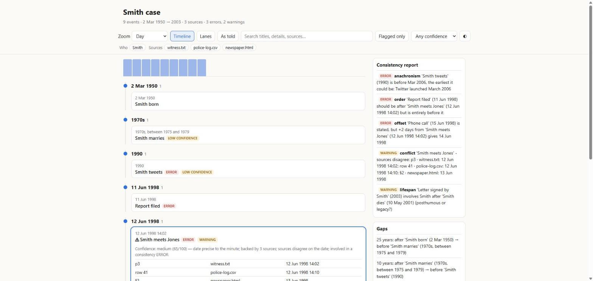
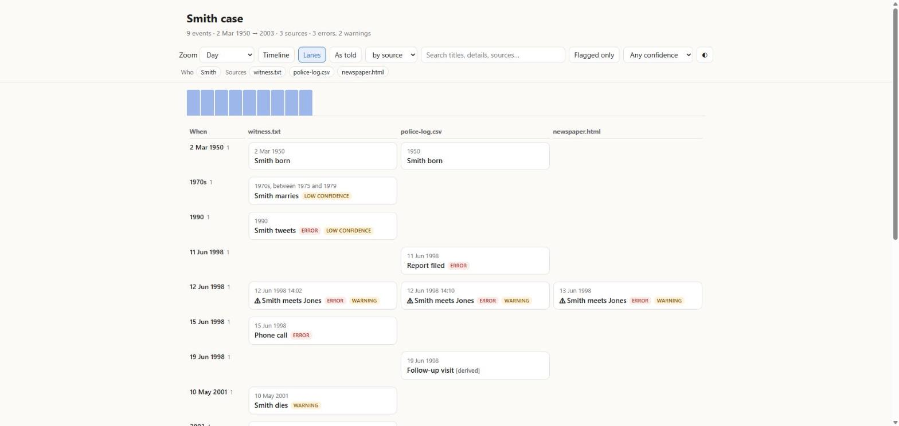

# CHRONOLOGY: timelines that don't invent dates

[](https://github.com/gauravnavgire/chronology/actions/workflows/tests.yml)
[](LICENSE)
[](chronology/SKILL.md)
[](chronology/scripts/chronology.py)

An **Agent Skill** for Claude, plus a standalone **Python CLI**. It turns notes,
PDFs, books, logs, CSV files and databases into **checked chronologies**:

- vague dates stay vague
- sources that disagree are flagged
- contradictions are reported
- every event is checked against the source's own words

**[▶ Try the interactive demo](https://gauravnavgire.github.io/chronology/)** ·
[Full guide](docs/GUIDE.md) · [Download the skill](https://github.com/gauravnavgire/chronology/releases/latest)



## Why

Ask an LLM for a timeline and it will quietly turn "July 1969" into 16 July,
pick one of three conflicting times, and sort Old Style dates as if they were
modern. CHRONOLOGY handles each of those differently:

| Problem | What CHRONOLOGY does |
|---|---|
| Fake precision | Every date is a **window** ("late 1970s" = 1975–1979). Orderings the source doesn't establish are marked ≈ |
| Conflicting sources | Merges them, counts corroboration, and marks ⚠ with **each source's own date** |
| Contradictions | Reports impossible orderings, broken "3 days later" claims, people acting after their death, and anachronisms |
| Calendars | Julian, Hijri, Hebrew, Japanese eras, regnal and fiscal years, and the **Hindu panchang**, computed from the Sun and Moon |
| Hallucinated details | A **self-check** looks up every event's quote in the source: invented quotes, misquotes, wrong pages, wrong years |

Shakespeare and Cervantes both "died on 23 April 1616", eleven days apart.
CHRONOLOGY puts them in the right order.



## Install

**Claude.ai / Claude Desktop.** Download `chronology.zip` from the
[latest release](https://github.com/gauravnavgire/chronology/releases/latest),
then go to *Customize → Skills → Upload*.

**Claude Code.**

```bash
git clone https://github.com/gauravnavgire/chronology
cp -r chronology/chronology ~/.claude/skills/          # macOS / Linux
# Windows (PowerShell):
# Copy-Item -Recurse chronology\chronology $HOME\.claude\skills\
```

**Command line (no Claude needed).** Python 3.9+, standard library only. From
the repository root:

```bash
python chronology/scripts/chronology.py events.json -g day -l tree
python chronology/scripts/chronology.py orders.csv -g month -l table
python chronology/scripts/chronology.py a.json b.json c.json -l html -o timeline.html
```

## Try it

Once the skill is installed, just ask:

> *"Here are two witness statements and the police dispatch log. Merge them
> into one chronology and tell me where the accounts disagree."*

> *"Convert the Samvat dates in our family record book and put the events in order."*

> *"Which milestones in these status reports slipped, and by how much? Week-level timeline."*

Claude extracts the events, with a quote for each, runs the script, checks
the quotes against your source, and answers with the chronology, the
conflicts and a consistency report.

## What's inside

| | |
|---|---|
| **Layouts** | tree, timeline, table, bullets, Mermaid, CSV, JSON, density (gaps and bursts), lanes (swimlanes), telling order (flashbacks), interactive HTML |
| **Exports** | iCalendar `.ics`, Mermaid Gantt, TimelineJS, vis-timeline |
| **Granularity** | millennium → century → … → day → hour → minute → second |
| **Inputs** | any text Claude can read; CSV, TSV and SQLite read directly (date-column detection, day/month order, epoch and Excel times) |
| **Questions** | `--how-long A B` (with bounds), `--as-of DATE`, `--before` / `--after`, date ranges, filters |
| **Presets** | `incident`, `legal`, `biography`, `history`, `project` (planned vs. actual), `story` |
| **Re-runs** | `--state` reports what changed since last time |

See the **[full guide](docs/GUIDE.md)** for details and examples.

## How well does it work?

- **45 unit tests** check the engine against known answers. Calendar
  conversions are checked against published dates. For example:
  - new moons match to within 1 minute
  - the Ram Navami and Holi tithi timings match to within about 2 minutes
  - historical records are reproduced: Shivaji's coronation in 1674 and
    Gandhi's birth tithi in 1869
- **Real Claude sessions** on 14 test documents with answer keys
  ([full results](eval/RESULTS.md)). Where the skill ran:

  | | Result |
  |---|---|
  | Events found | **98 of 99** (every must-have event) |
  | Dates exactly right | **97 of 98** |
  | Vague dates given false precision | **0** |
  | Events with a source quote | **100%** |
  | Used when it should be (12 test prompts) | **4 of 6**, with **0 of 6** false triggers |

  The test documents were written for the evaluation, and each prompt ran
  once, so treat these as indicative. The [evaluation kit](eval/) can be
  re-run, and real-world test cases are welcome.
- **Known limits:** Claude still does the reading, so a missed date is still
  missed. The self-check catches invented and misquoted events, not missing
  ones. Hindu solar calendars and the Chinese calendar aren't supported yet.

## Contributing

Issues and pull requests are welcome. See [CONTRIBUTING.md](CONTRIBUTING.md)
for good first issues (more calendars, more date languages, Excel input) and
how to run the tests.

## License

[MIT](LICENSE)
