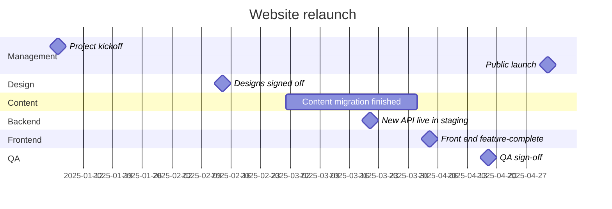

Consistency report:
- WARNING [schedule] 'Designs signed off' (14 Feb 2025) happened after its planned date (7 Feb 2025): late by 7 days
- WARNING [schedule] 'Content migration finished' (Mar 2025) happened after its planned date (28 Feb 2025): late by up to 1.1 months
- WARNING [schedule] 'Front end feature-complete' (4 Apr 2025) happened after its planned date (21 Mar 2025): late by 14 days
- WARNING [schedule] 'Public launch' (2 May 2025) happened after its planned date (11 Apr 2025): late by 21 days
- INFO [schedule] 'New API live in staging' (21 Mar 2025) happened before its planned date (28 Mar 2025): early by 7 days
- INFO [order] 1 event(s) marked ≈ could have happened before the event listed just above them (their possible date ranges overlap).
