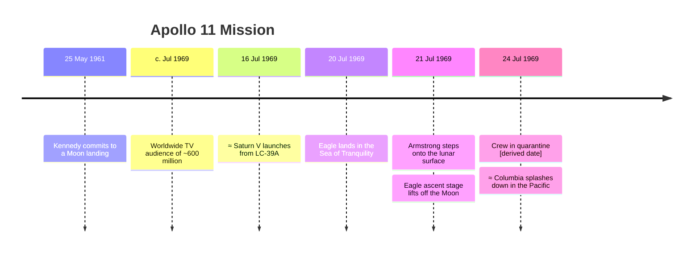

Undated / unresolved:
- Plaque left on the Moon

Consistency report:
- INFO [order] 2 event(s) marked ≈ could have happened before the event listed just above them (their possible date ranges overlap).
