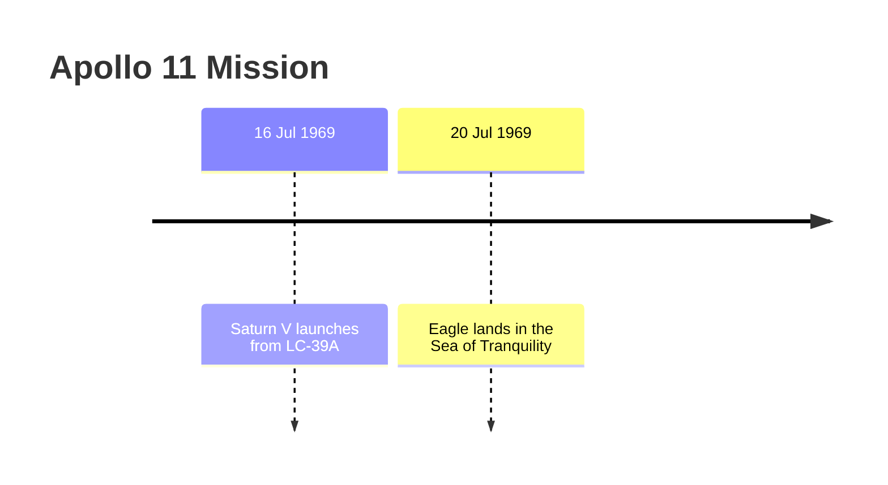

# Layouts

Pick the layout from the user's wording:

| User says | Layout | Script flag |
|---|---|---|
| tree, hierarchy, nested, drill-down | **tree** | `-l tree` |
| timeline, vertical timeline, sequence | **timeline** | `-l timeline` |
| table, tabular, grid, spreadsheet-like | **table** | `-l table` |
| bullet points, indented, outline, list | **bullets** | `-l bullets` |
| diagram, visual timeline, Mermaid | **mermaid** | `-l mermaid` |
| CSV, Excel, import into a sheet | **csv** | `-l csv` |
| JSON, structured, for code or APIs | **json** | `-l json` |
| how busy, histogram, density, gaps, quiet periods | **density** | `-l density` |
| side by side, per person/source/theme, swimlanes, parallel | **lanes** | `-l lanes --tracks <field>` |
| interactive, explorable, web page, shareable, zoomable | **html** | `-l html -o chronology.html` |
| as told, narrative order, flashbacks, story vs. plot | **telling** | `-l telling` |
| calendar file, import into Google/Outlook/Apple Calendar | **ics** | `-l ics -o events.ics` |
| Gantt chart, schedule chart, project plan | **gantt** | `-l gantt` |
| TimelineJS, Knight Lab timeline, storytelling embed | **timelinejs** | `-l timelinejs -o timeline.json` |
| vis-timeline, vis.js, items for a web app | **vis** | `-l vis -o items.json` |

Ready-made outputs for every layout, all built from `examples/apollo11-events.json`,
are in `examples/output-*`.

## tree

Box-drawing hierarchy of periods (top level → granularity). Events hang
from the deepest period that their precision allows. Wrap it in a code block.

```
Apollo 11 Mission
└── 1969
    └── Jul
        ├── Worldwide TV audience of ~600 million (c. Jul 1969) [para 8]
        ├── 16 Jul
        │   └── Saturn V launches from LC-39A (16 Jul 1969 13:32) [para 2]
        └── 20 Jul
            └── Eagle lands in the Sea of Tranquility (20 Jul 1969 20:17:40) [para 4]
```

## timeline

A vertical spine. Each period at the granularity is a ◆ marker, with its
events and their context indented below. Wrap it in a code block.

```
Apollo 11 Mission
│
◆ 16 Jul 1969
│   • Saturn V launches from LC-39A (16 Jul 1969 13:32) [para 2]
│       Crew: Armstrong, Aldrin, Collins
│
◆ 20 Jul 1969
│   • Eagle lands in the Sea of Tranquility (20 Jul 1969 20:17:40) [para 4]
│       Armstrong: "The Eagle has landed."
│
▼
```

## table

A Markdown table with one row per event. `When` is the period at the
requested granularity. `Exact date` (hide it with `--no-exact`) keeps the
full precision.

| # | When | Exact date | Event | Details | Source |
|---|---|---|---|---|---|
| 1 | 16 Jul 1969 13:32 | 16 Jul 1969 13:32 | Saturn V launches from LC-39A | Crew: Armstrong, Aldrin, Collins | para 2 |
| 2 | 20 Jul 1969 20:17 | 20 Jul 1969 20:17:40 | Eagle lands in the Sea of Tranquility | "The Eagle has landed." | para 4 |

## bullets

A Markdown outline. Periods are **bold** bullets, and events are nested
bullets under them. Indent two spaces per level.

```markdown
- **1969**
  - **Jul**
    - Saturn V launches from LC-39A (16 Jul 1969 13:32) — Crew: ... [para 2]
    - Eagle lands in the Sea of Tranquility (20 Jul 1969 20:17:40) — ... [para 4]
```

## mermaid

A Mermaid `timeline` diagram that renders in GitHub, Notion, Obsidian, and
Mermaid tools. Colons, semicolons and `#` are removed from labels. Use a
coarser granularity (month/year) when there are more than about 30 events.



## csv

Columns: `order, when, exact, precision, approximate, title, details, source, tags`.
Save it with `-o file.csv` for spreadsheets.

## json

A nested `{period, level, events[], children[]}` tree that matches the tree
layout. Every event keeps its original fields, plus `when` and `exact`.

## density

A histogram of events per period at the granularity. Empty periods are shown,
and runs of 4 or more empty periods are collapsed into one line. Below it are
the **largest gaps** and the **busiest periods**. Wrap it in a code block.

```
25 May 1961 │████████████████████ 1
            ┊ 2973 empty days (26 May 1961 – 15 Jul 1969)
16 Jul 1969 │████████████████████ 1
17 Jul 1969 │
21 Jul 1969 │████████████████████████████████████████ 2

Largest gaps (periods in which no event can have happened):
- 8 years: after 'Kennedy commits to a Moon landing' (25 May 1961) → before 'Worldwide TV audience…' (c. Jul 1969, …)

Busiest periods (by day):
- 21 Jul 1969: 2 events (29% of events placed at this level)
```

- Gaps are **certain**: they run from the latest possible moment of
  everything before to the earliest possible moment of the next event.
  Approximate dates therefore shrink gaps; they never invent them.
- Events dated more coarsely than the granularity aren't counted in the
  histogram. Their number is stated.
- `--gaps` appends the gaps and busiest-periods summary to any text layout.

## lanes

Parallel tracks: one row per period, one column per lane. Lanes come from
`--tracks`:

| `--tracks` | Lanes | Good for |
|---|---|---|
| `entities` (who, people) | each person or organisation | biographies, investigations |
| `tags` (themes, topics) | each theme | histories, projects |
| `source` (documents) | each source document | comparing accounts. Each lane shows **that source's own date**, so disagreements line up side by side |
| any other field | its values, e.g. `--tracks location` | custom |

If `--tracks` isn't given, the first of entities, tags and source that has
values is used. `--lanes A,B` keeps only those lanes, in that order. An event
with several values appears in each of their lanes. Events with no value go
to `(other)`.

| When | witness.txt | police-log.csv | newspaper.html |
|---|---|---|---|
| 12 Jun 1998 | ⚠ Smith meets Jones (12 Jun 1998 14:02) | ⚠ Smith meets Jones (12 Jun 1998 14:10) | ⚠ Smith meets Jones (13 Jun 1998) |

## html

A single, self-contained HTML file. It has no external resources, works
offline, supports light and dark themes, and fits phone screens. Always
write it with `-o name.html`. The page offers:

- **Zoom**: switch granularity live, from millennium down to the finest
  precision in the data.
- **Timeline / Lanes views**: lanes by entities, tags or source.
- **Search** across titles, details, sources and labels.
- **Filter chips** for people, tags and sources, plus "Flagged only" for
  events marked ≈, ⚠ or with issues.
- **Density strip**: one bar per period. Click a bar to jump to it.
- **Expandable event cards** showing details, the window of possible dates,
  every source with the date it gives, and any issues.
- **Side panel** with the consistency report, gaps, busiest periods,
  undated items and a legend. Clicking an issue or a gap highlights and opens
  the events involved.

Tell the user the file path and that it opens in any browser. If the
environment can publish or share pages, offer to do so.

## telling

Compares the order in which the source **tells** events with the order in
which they **happened**. This is useful for novels, memoirs, films,
testimony and interviews. Each row is an event in telling order, with its
story position and its movement:

| Movement | Meaning |
|---|---|
| ↩ flashback N | Certainly before the main storyline's current point, by about N |
| ↩ flashback continues | Still inside the same flashback, moving forward |
| ↪ flash-forward N (skips K events told later) | Jumps past events the source will tell afterwards |
| → resumes | Back on the main storyline after an excursion |
| ≈ told after, may be earlier | Windows overlap, so the order isn't established |

The summary line counts flashbacks and flash-forwards, and gives
**linearity**: the share of steps that move forward in story time. With
several sources, each source's telling is analysed separately. See
`examples/story/output-telling.md`.

| Told | Story # | When | Event | Movement |
|---|---|---|---|---|
| 1 | 4 | Mar 1999 | Anna returns to the village for her father's funeral |  |
| 2 | 1 | Jul 1975 | Anna, aged eight, learns to swim in the lake | ↩ flashback 24 years |
| 3 | 5 | Mar 1999 | The will is read | → resumes |
| 4 | 8 | 2010 | Years later, Anna regrets selling the house | ↪ flash-forward 11 years (skips 2 events told later) |

## Exports

| Layout | Output | Notes |
|---|---|---|
| `ics` | iCalendar (RFC 5545): CRLF line endings, lines folded at 75 octets, a stable UID per event | Day-or-coarser dates become all-day events spanning the whole period (`c. Jul 1969` covers 1–31 July). Times are UTC. The description holds the exact date, details, sources and confidence |
| `gantt` | Mermaid `gantt` | Single dates become milestones, ranges and coarse dates become bars. Sections are lanes (`--tracks`). Uses `HH:mm` when any event has a time |
| `timelinejs` | TimelineJS 3 JSON | Keeps BCE (negative years), `display_date` shows the exact or original-calendar wording, `group` is the first lane |
| `vis` | `{items, groups}` for vis-timeline | Points for single dates, ranges otherwise. Groups are lanes |

Calendar, Gantt and vis exports need years 1–9999. Events outside that range
are left out and the count is reported on stderr.

## Answers, confidence and presets

- **Answers** to questions (`--how-long`, `--as-of`, `--before`, `--after`,
  `--from` / `--to`) are printed as an `Answer:` block above any text
  layout. They go in the `answer` key in JSON, in a highlighted box in HTML,
  and to stderr for CSV. `--answer-only` prints only the answer.
- **Confidence** is a column in `table`, `confidence*` columns in `csv`, a
  `confidence` object in `json`, and a badge, card line and filter in `html`.
  Other layouts mark `[low confidence]` events only.
- **Presets** pick the layout. See `options.md` for what each one sets.

## Changes since the last run

With `--state FILE` (or `--since` / `--save-state`), every layout gains a
**Changes since last run** section. Changed events are marked `[new]` or
`[date was …]`, and the html page shows NEW / CHANGED badges and a changes
panel. See `examples/incremental/`.

## Layouts not built into the script

Build these by hand from the sorted script output (`-l json` is easiest):

- **Horizontal ASCII timeline**: for 10 events or fewer.
  ```
  1961 ──●──────────────────── 1969 ──●──●──●──●──
        Kennedy speech            launch landing EVA splashdown
  ```
- **Mermaid Gantt**: for ranges with start and end (`gantt` + `dateFormat YYYY-MM-DD`).
- **Narrative**: one paragraph per period, in prose.

## Combined requests

- "tree by century, events by year" → `-g year -l tree --top century`
- "table at hour level but only 20 July" → filter the events JSON first, then `-g hour -l table`
- "newest first" → `--reverse`
- "just headlines" → strip `details` before rendering, or use the mermaid or csv layout
- "where are the quiet years?" → `-g year -l density`
- "what was each person doing at the time?" → `-l lanes --tracks entities`
- "compare the three accounts side by side" → several files, `-l lanes --tracks source`
- "something I can click through and share" → `-l html -o chronology.html`
